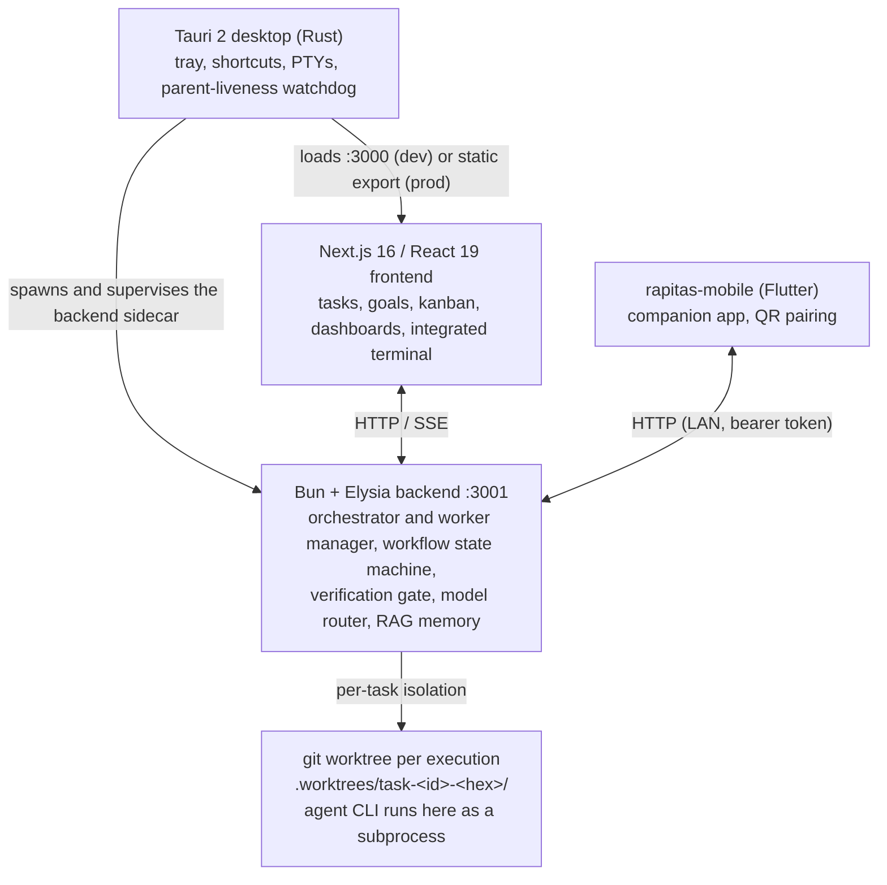

<h1 align="center">rapitas</h1>

<p align="center">
  <strong>A local-first AI engineering workbench.</strong><br/>
  Autonomous coding agents that research → plan → implement → verify a task <strong>inside an isolated git worktree</strong>, gated by an automated <strong>verification gate</strong> (lint, type-check and the tests of the changed files) before any commit or PR — shipped as a Next.js web app <em>and</em> a Tauri/Rust desktop app over a Bun/Elysia backend.
</p>

<p align="center">
  <em>Built for my own workflow; published as an engineering showcase.</em>
</p>

<p align="center">
  <a href="LICENSE"></a>
  
  
  
  
</p>

<!-- TODO: 90-second demo GIF/video here — agent picks up a task → research/plan → edits code in a worktree → verification gate runs → PR opened. Single highest-leverage thing to add. -->

---

## At a glance (what this demonstrates)

| Area | What it shows |
| --- | --- |
| **Agentic systems** | Not just an LLM API call — the *orchestration*: isolated execution, a quality gate, a self-repair retry loop, and a workflow state machine. |
| **Systems / OS-level** | Real PTY (ConPTY) integration, multi-process lifecycle, graceful shutdown, and a kernel-socket-leak fix that previously required a reboot. |
| **End-to-end ownership** | Three runtimes — Tauri/Rust desktop, Bun/Elysia backend, Next.js/React frontend — integrated by one person. |
| **Engineering maturity** | ADRs, enforced code/comment/folder policies, an automated agent-output gate, profiled-and-fixed startup performance, CI (lint + type-check + Rust clippy + a curated blocking test suite, full suite advisory). |
| **Product polish** | Fully bilingual (English / 日本語) UI via next-intl — every user-facing string localized, switchable at runtime. |

**Stack:** Tauri 2 + Rust · Bun + Elysia + Prisma (SQLite local / PostgreSQL web) · Next.js 16 + React 19 + Tailwind 4 + TypeScript · multi-provider LLMs (Claude / OpenAI / Gemini) + local LLM (Ollama) + RAG embeddings.

---

## The problem I set out to solve

AI coding agents are powerful but **unsafe by default**: they edit files in place, happily produce broken diffs, and flood you with PRs to babysit. I wanted an agent that could take a task and *actually finish it* — without (a) touching my working tree while I work, (b) shipping code that doesn't lint or type-check, or (c) locking me into one AI CLI. So rapitas is built on three opinions:

1. **Isolate the agent.** Every *code-mutating* run (implementer/verifier) happens in a throwaway git worktree — and if that isolation can't be established, the run is **refused** rather than falling back to the main checkout. Read-only research/plan phases run against the live tree with Bash/Edit/Write/git tools disabled at the CLI level.
2. **Gate the output.** No diff becomes a commit/PR until an automated verification gate (lint, type-check, the tests of the changed files, and more) passes — and if it fails, the agent is sent back to fix its own mess (bounded retries).
3. **Don't get locked in.** Claude Code / Codex / Gemini are interchangeable, with model-tier routing and fallback.

---

## Architecture



Details: [docs/ARCHITECTURE.md](docs/ARCHITECTURE.md) · design decisions: [docs/adr/](docs/adr/).

---

## Hero engineering achievements

### 1. Safe autonomous agent execution → **[full deep-dive](docs/deep-dive/safe-agent-execution.md)**

An agent runs the `research → plan → implement → verify` workflow inside an isolated worktree; an automated **verification gate** (ESLint, `tsc --noEmit` and the tests for the files the agent changed, plus checks for missing tests, test tampering, plan scope, file size and a runtime smoke test) must pass before any commit/PR. On failure, a **self-repair loop** re-runs the agent in the *same* worktree with the failed checks as feedback (default 2 retries), and the gate guards **both** auto-PR paths. The gate is **fail-closed on the check result**: if a check can't run or its output can't be parsed, that check is treated as a failure and the task is blocked, never waved through. (One deliberate carve-out: an unexpected *crash in the verifier harness itself* fails open, so a bug in the gate can't wedge every task — the tradeoff is documented in the code.) A workflow state machine prevents out-of-order or regressive steps, and self-contradictory verify reports ("all tests pass" + failures) can't trigger a PR.

### 2. Resilient multi-process desktop lifecycle

A Tauri app supervising a Bun backend, a Next.js frontend, agent workers, a Whisper voice daemon, and a local-LLM sidecar — across `tauri dev`, tray-quit, and hard window-close on Windows. I diagnosed and fixed a class of bug where half-closed SSE/polling connections orphaned as `CLOSE_WAIT` zombie sockets on port 3001, eventually requiring a reboot: a **force-close-on-shutdown** (`server.stop(true)`), a **parent-liveness watchdog** that shuts down gracefully even when no signal is delivered, and a layered port-reclamation strategy.

### 3. Multi-model routing with cost awareness

Provider **probes** (Claude/OpenAI/Gemini/Ollama) discover available models, classify them into tiers (`premium → standard → economy → free`), and a router picks by preferred-provider / free-first / cheapest-per-1k-tokens with automatic tier fallback (cached 5 min). Token/cost is tracked per execution.

---

## Why rapitas (and who it's for)

rapitas suits **a developer who wants AI to do real work on their own machine** — someone who:

- **won't ship source to a cloud** (client work, policy, or preference);
- **doesn't want to be locked to one AI CLI** — switch Claude Code / Codex / Gemini per task, fall back when one fails;
- **is tired of AI "noise PRs"** — wants broken diffs stopped *before* review;
- **wants AI cost visibility** — token/cost tracking, response cache, local LLM.

### vs. Linear / GitHub Copilot

| | rapitas | Linear (AI Agents) | GitHub (Copilot agent) |
| --- | --- | --- | --- |
| **Pre-generation quality gate** | Yes: lint/type-check catches errors the agent introduced and **stops PR generation** | Partly: PR review, weak pre-generation block | No: generate first → human review |
| **Multi-CLI / model fallback** | Yes: Claude Code / Codex / Gemini, `--resume → --continue → new session` | No: single agent | No: Copilot only |
| **Local / privacy** | Yes: Tauri-native + local LLM + response cache | No: cloud SaaS | No: cloud / Actions |
| **Team sync / collaboration** | Partly: single-user by design (GitHub = read + comment) | Yes, strong: bidirectional sync | Yes, strong: native |

> Competitor column summarizes public info as of 2026-04. **Not a fit if** you need a team PM hub or bidirectional issue↔PR sync — Linear / GitHub are better there.

---

## How this was built (honest note)

Developed **AI-augmented** — I used coding agents heavily (including rapitas-style workflows and Claude Code). What I own and can defend in depth: the **architecture**, the **isolation + verification-gate design**, the **process/socket lifecycle fixes**, and the **quality gates** that keep AI-generated code honest. Directing AI tooling toward a correct, maintainable system is the engineering skill this project demonstrates.

---

## Getting started

```bash
git clone https://github.com/takamurayuki/rapitas.git && cd rapitas
npm run setup:desktop                 # SQLite desktop build (recommended)
cd rapitas-desktop && node scripts/dev.js
```

Full setup (Web/PostgreSQL build, individual processes, commands, troubleshooting): **[docs/SETUP.md](docs/SETUP.md)**.

---

## Limitations & roadmap

- **Local-first / single-user** by design; **cloud sync / multi-device / team** would need data scoped by `userId` + a sync service (intentionally out of scope today).
- GitHub integration is **read + comment** oriented; bidirectional issue↔PR sync is not a goal.

---

## Documentation

- [Deep-dive: Safe autonomous agent execution](docs/deep-dive/safe-agent-execution.md)
- [Architecture](docs/ARCHITECTURE.md) · [ADRs](docs/adr/)
- [Setup & development](docs/SETUP.md) · [Performance notes](docs/PERFORMANCE.md) · [Runbook](docs/RUNBOOK.md)
- [.claude/CLAUDE.md](.claude/CLAUDE.md) — AI agent operating rules

## License

[Apache License 2.0](LICENSE)
