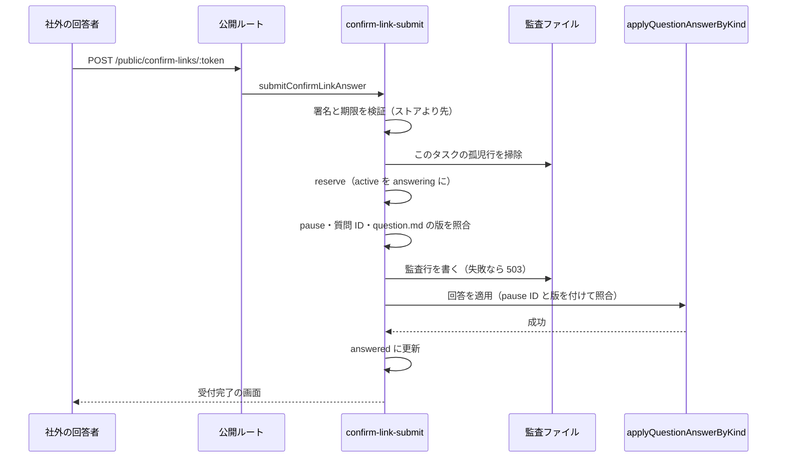

# 社外確認リンク

社外の関係者に、ブロック中の判断事項 1 件を A/B の二択で答えてもらうための仕組みです。リンクはログインなしで開けます。有効期限は発行から 24 時間で、回答は 1 回だけ受け付けます。

## 対象となる判断事項

発行できるのは、タスクが `awaiting_question` で、question.md の `json:options` に質問が 1 問だけあり、次の条件をすべて満たす場合です。条件を満たさないと発行は 422 `confirm_link_ineligible` になります。

- 選択肢がちょうど 2 個である
- `freeTextRequired` が `false` である
- `mutatesGate` と `requiresOperatorAction` の付いた選択肢が無い

## 有効化と公開経路

既定では無効です。公開系のルートはすべて 404 を返し、発行は 409 `confirm_link_disabled` になります。

| 環境変数                             | 役割                                                                                  |
| ------------------------------------ | ------------------------------------------------------------------------------------- |
| `RAPITAS_CONFIRM_LINK_SECRET`        | トークンの HMAC 署名鍵。32 文字以上で有効になる                                       |
| `RAPITAS_CONFIRM_LINK_PUBLIC_ORIGIN` | 発行する URL の先頭に付ける公開ホスト。未設定なら相対パスを返し、発行画面に警告を出す |

> [!IMPORTANT]
> リバースプロキシやトンネルで外部へ転送するのは `/public/confirm-links/` の前置パスだけにしてください。それ以外のパスを転送すると、認証の無い API 全体が外部に露出します。

`RAPITAS_API_TOKEN` を設定している場合も、API トークンガードは `^/public/confirm-links/[^/]+(/resources/\d+)?/?$` に一致するパスだけを素通しします（`rapitas-backend/middleware/local-auth.ts`）。他のルートは従来どおりトークンが必要です。

## ルート

| メソッドとパス                                                 | 利用者                                       | 内容                                                                                                                  |
| -------------------------------------------------------------- | -------------------------------------------- | --------------------------------------------------------------------------------------------------------------------- |
| `POST /workflow/tasks/:taskId/confirm-links`                   | 社内（`X-Rapitas-Source: ui` か `operator`） | リンクを発行する。同じタスクの有効なリンクは失効させる                                                                |
| `GET /workflow/tasks/:taskId/confirm-links`                    | 社内                                         | リンクの状態と、資料ごとの「外部公開可」フラグを返す。トークンは返さない                                              |
| `PUT /workflow/confirm-links/resources/:resourceId/visibility` | 社内（`X-Rapitas-Source` 必須）              | 資料の「外部公開可」フラグを切り替える。ワークスペースから見えない資料やタスクに属さない資料は 404 で、タグを書かない |
| `GET /public/confirm-links/:token`                             | 社外                                         | 回答画面の HTML                                                                                                       |
| `POST /public/confirm-links/:token`                            | 社外                                         | 回答を受け付ける                                                                                                      |
| `GET /public/confirm-links/:token/resources/:resourceId`       | 社外                                         | 公開可の資料ファイルを `attachment` で配信する                                                                        |

発行画面は、タスク詳細のワークフロー Q&A タブで、構造化された質問の下にある「社外確認リンク」ボタンから開きます（`rapitas-frontend/src/components/workflow/confirm-link/`）。

## 回答の流れ

回答は、監査行を書いてから適用します。適用より後の書き込みはディスク満杯や再起動で失敗し得るので、適用の前に書く順序だけが「適用したのに監査が無い」状態を防げます。処理は `rapitas-backend/services/workflow/confirm-link/confirm-link-submit.ts` にあります。

1. 署名と期限を検証する。署名が不正ならストアを読まない。
2. このタスクの孤児行（後述）を掃除する。
3. リンクを `active` から `answering` に予約する。
4. タスクが同じ pause・同じ質問 ID・同じ question.md の版で待っているかを照合する。
5. 監査行を書く。書けなければ予約を戻して 503 を返し、回答は適用しない。
6. 回答を適用する。`applyQuestionAnswerByKind` はタスクのロックの中で pause ID と版をもう一度照合する。
7. 成功したらリンクを `answered` にする。

### 応答

| 状況                                                               | 応答                                      | リンク                           | 監査            |
| ------------------------------------------------------------------ | ----------------------------------------- | -------------------------------- | --------------- |
| 署名不正・形式不正・鍵不一致                                       | 404。質問の内容は返さず、ストアも読まない | 変更なし                         | 0 件            |
| 発行から 24 時間以上経過                                           | 410                                       | 変更なし                         | 0 件            |
| 回答済み・回答処理中・失効済み                                     | 410                                       | 変更なし                         | 変更なし        |
| 社内で先に回答された、または質問が置き換わった                     | 410                                       | `revoked`                        | 0 件            |
| 予約の後にタスクや question.md を読めない                          | 500                                       | `active` に戻す                  | 0 件            |
| 監査行を書けない                                                   | 503「一時的に受け付けできません」         | `active` に戻す                  | 0 件            |
| 適用が 409 または 404 で拒否された                                 | 410（停止中なら 409）                     | `revoked`                        | 補償削除で 0 件 |
| 適用が想定外の例外で失敗し、質問がまだ待っている                   | 500                                       | `active` に戻す                  | 補償削除で 0 件 |
| 適用が想定外の例外で失敗し、質問が待っていない、または読み直せない | 500「受付状態を確認できませんでした」     | `answering` のまま（再送は 410） | 1 件を保持      |
| 適用後に `answered` への更新だけ失敗した                           | 200                                       | `answering` のまま               | 1 件            |

適用されたかどうか判別できないときは、監査を保持する側に倒します。消すと「適用された回答に監査が無い」状態になり得るためです。停止の上書き（`stopOverride`）は渡しません。回答の変更や再回答は、社内の作業者が通常の回答経路で行います。

### 監査の不変条件と孤児の掃除

監査行がある期間は、そのリンクが `answering` か `answered` のときに限られます。

| リンクの状態 | 監査行                             |
| ------------ | ---------------------------------- |
| `active`     | 無い。あれば補償削除が失われた孤児 |
| `answering`  | 有る                               |
| `answered`   | 有る                               |
| `revoked`    | 無い。あれば孤児                   |

補償削除そのものが失敗した行は残ります。次にそのタスクでリンクを発行するか回答を送るとき、リンクが `active` か `revoked` の行を消します。判定は監査ファイルのロックの中で行います。予約は監査の書き込みより先に終わるので、書き込み中の行のリンクは既に `answering` で、掃除の対象になりません。リンクの記録が既に消えている行は判別できないので保持します。

### 質問の版

発行時に question.md の本文そのものの SHA-256 を `questionDigest` として記録します。同じ pause・同じ質問 ID のまま本文が再保存されると版が変わり、旧リンクは表示時も回答時も失効します。適用時にもロックの中で照合します。監査行にも回答者が見た版を残します。

## 表示する内容

回答画面に出すのは、発行者が入力した依頼文、質問の要約、選択肢の文言と影響、「外部公開可」の資料だけです。question.md の本文は表示しません。社内限定の情報が混ざり得るためです。可変の文字列はすべて HTML エスケープし、Markdown は描画しません。

資料はタグの無いものを非公開として扱います。ID を直接指定しても、そのタスクの公開可の資料でなければ 404 になります。

公開ルートの応答には次のヘッダを付けます。

- `Cache-Control: no-store`
- `Referrer-Policy: no-referrer`
- `X-Content-Type-Options: nosniff`
- `X-Frame-Options: DENY`
- `Content-Security-Policy: default-src 'none'; style-src 'unsafe-inline'; form-action 'self'; img-src 'self'`

## 保存先と保持期間

Prisma のスキーマは変更していません。スキーマを変えるとサーバーの再起動が必要になるためです。状態は、サイクルログと同じディレクトリにある confirm-links ディレクトリに置きます（実行時に作られ、リポジトリには含まれません）。

| ファイル           | 内容                                                                                                                           | 保持期間                          |
| ------------------ | ------------------------------------------------------------------------------------------------------------------------------ | --------------------------------- |
| links.json         | リンクの状態（`active`・`answering`・`answered`・`revoked`）                                                                   | 失効から 7 日で、次の発行時に削除 |
| resource-tags.json | 資料 ID ごとの `external_public` タグ                                                                                          | タグを外すまで                    |
| `audit.ndjson`     | 回答 1 件につき 1 行。回答者名（自己申告）・回答日時・経路 `external_confirm_link:<linkId>`・質問の版。同じ ID は 2 回書かない | 180 日。追記時に古い行を削除      |

回答者名は認証されていない自己申告です。IP アドレスと User-Agent は保存しません。回答に伴う遷移の metadata にも `route` と `linkId` が残ります。

## 鍵のローテーション

`RAPITAS_CONFIRM_LINK_SECRET` を変えると、発行済みのリンクはすべて署名不正になります。リンクは 24 時間で失効するので、この影響は許容しています。
