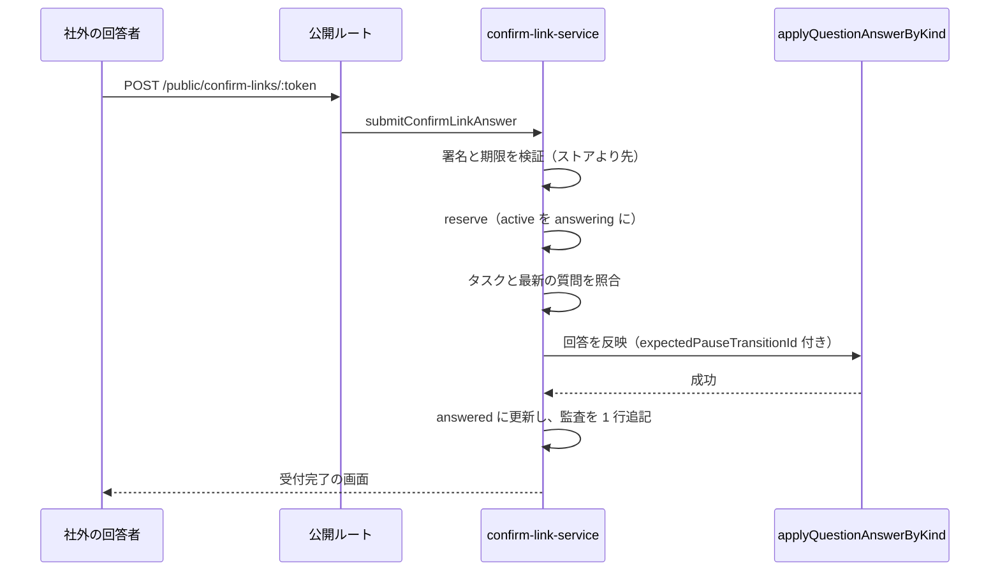

# 社外確認リンク

社外の関係者に、ブロック中の判断事項 1 件を A/B の二択で答えてもらうための仕組みです。リンクはログインなしで開けます。有効期限は発行から 24 時間で、回答は 1 回だけ受け付けます。

## 対象となる判断事項

発行できるのは、タスクが `awaiting_question` で、question.md の `json:options` に質問が 1 問だけあり、次の条件をすべて満たす場合です。条件を満たさないと発行は 422 `confirm_link_ineligible` になります。

- 選択肢がちょうど 2 個である
- `freeTextRequired` が `false` である
- `mutatesGate` と `requiresOperatorAction` の付いた選択肢が無い

## 有効化と公開経路

既定では無効です。公開系のルートはすべて 404 を返し、発行は 409 `confirm_link_disabled` になります。

| 環境変数 | 役割 |
| --- | --- |
| `RAPITAS_CONFIRM_LINK_SECRET` | トークンの HMAC 署名鍵。32 文字以上で有効になる |
| `RAPITAS_CONFIRM_LINK_PUBLIC_ORIGIN` | 発行する URL の先頭に付ける公開ホスト。未設定なら相対パスを返し、発行画面に警告を出す |

> [!IMPORTANT]
> リバースプロキシやトンネルで外部へ転送するのは `/public/confirm-links/` の前置パスだけにしてください。それ以外のパスを転送すると、認証の無い API 全体が外部に露出します。

`RAPITAS_API_TOKEN` を設定している場合も、API トークンガードは `^/public/confirm-links/[^/]+(/resources/\d+)?/?$` に一致するパスだけを素通しします（`rapitas-backend/middleware/local-auth.ts`）。他のルートは従来どおりトークンが必要です。

## ルート

| メソッドとパス | 利用者 | 内容 |
| --- | --- | --- |
| `POST /workflow/tasks/:taskId/confirm-links` | 社内（`X-Rapitas-Source: ui` か `operator`） | リンクを発行する。同じタスクの有効なリンクは失効させる |
| `GET /workflow/tasks/:taskId/confirm-links` | 社内 | リンクの状態と、資料ごとの「外部公開可」フラグを返す。トークンは返さない |
| `PUT /workflow/confirm-links/resources/:resourceId/visibility` | 社内（`X-Rapitas-Source` 必須） | 資料の「外部公開可」フラグを切り替える |
| `GET /public/confirm-links/:token` | 社外 | 回答画面の HTML |
| `POST /public/confirm-links/:token` | 社外 | 回答を受け付ける |
| `GET /public/confirm-links/:token/resources/:resourceId` | 社外 | 公開可の資料ファイルを `attachment` で配信する |

発行画面は、タスク詳細のワークフロー Q&A タブで、構造化された質問の下にある「社外確認リンク」ボタンから開きます（`rapitas-frontend/src/components/workflow/confirm-link/`）。

## 回答の流れ

| 状況 | 応答 |
| --- | --- |
| 署名不正・形式不正・鍵不一致 | 404。質問の内容は返さず、ストアも読まない |
| 発行から 24 時間以上経過 | 410 |
| 回答済み・回答処理中・失効済み | 410 |
| 社内で先に回答された、または質問が置き換わった | 410。リンクを失効させる |
| タスクが停止中 | 409。停止の上書きはしない。リンクを失効させる |

回答の変更や再回答は、社内の作業者が通常の回答経路で行います。

## 表示する内容

回答画面に出すのは、発行者が入力した依頼文、質問の要約、選択肢の文言と影響、「外部公開可」の資料だけです。question.md の本文は表示しません。社内限定の情報が混ざり得るためです。可変の文字列はすべて HTML エスケープし、Markdown は描画しません。

資料はタグの無いものを非公開として扱います。ID を直接指定しても、そのタスクの公開可の資料でなければ 404 になります。

公開ルートの応答には次のヘッダを付けます。

- `Cache-Control: no-store`
- `Referrer-Policy: no-referrer`
- `X-Content-Type-Options: nosniff`
- `X-Frame-Options: DENY`
- `Content-Security-Policy: default-src 'none'; style-src 'unsafe-inline'; form-action 'self'; img-src 'self'`

## 保存先と保持期間

Prisma のスキーマは変更していません。スキーマを変えるとサーバーの再起動が必要になるためです。状態はサイクルログと同じディレクトリの `confirm-links/` に置きます。

| ファイル | 内容 | 保持期間 |
| --- | --- | --- |
| `links.json` | リンクの状態（`active`・`answering`・`answered`・`revoked`） | 失効から 7 日で、次の発行時に削除 |
| `resource-tags.json` | 資料 ID ごとの `external_public` タグ | タグを外すまで |
| `audit.ndjson` | 回答 1 件につき 1 行。回答者名（自己申告）・回答日時・経路 `external_confirm_link:<linkId>` | 180 日。追記時に古い行を削除 |

回答者名は認証されていない自己申告です。IP アドレスと User-Agent は保存しません。回答に伴う遷移の metadata にも `route` と `linkId` が残ります。

## 鍵のローテーション

`RAPITAS_CONFIRM_LINK_SECRET` を変えると、発行済みのリンクはすべて署名不正になります。リンクは 24 時間で失効するので、この影響は許容しています。
