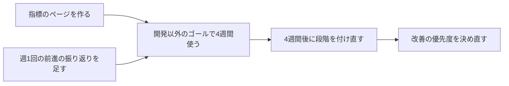

# 製品の目的に対する評価

rapitas が製品の目的（個人のゴールを具体化し、達成まで伴走すること）にどれだけ届いているかを測るための枠組みです。開発支援の自動実行の品質とは別の物差しで測ります。

## 製品の目的

rapitas は、やりたいことを実現できる道筋に変え、必要な知識や行動を補い、進捗と成果を確かめながらゴール達成まで伴走します。利用者が最初から正しい目標・計画・タスクを作れる必要はなく、一緒に考えること自体が価値です。

構成は2層です。

| 層 | 中身 |
| --- | --- |
| 共通部分 | ゴールの設定、道筋（ロードマップ）、進捗、意思決定、停滞への対応、達成の確認 |
| 分野ごとの支援 | 学習・創作・事業準備・開発など、分野ごとの実行の手段と確かめ方 |

いまの開発支援（エージェント、CI、検証のゲート）は、分野ごとの支援の一つです。

> [!IMPORTANT]
> 主な指標は、節目への到達率、停滞からの再開率、成果の品質、本人が感じる前進です。タスクの件数と利用時間は主な指標にしません。文書やタスクの量は達成の証拠になりません。

## 現状

2026-11-26 時点の状態です。

- 節目の部品はあります。`Milestone`（`rapitas-backend/prisma/schema/core.prisma`）は、合意した達成条件（`acceptanceCriteria`）、根拠（`evidence`）、到達の日時（`reachedAt`）、状態（`open`・`reached`・`paused`）を持ちます。
- 到達の判定と到達率の計算は `rapitas-backend/services/goals/milestone-achievement.ts` にあります。合意した条件をすべて確かめて根拠を書いたものだけを到達とし、タスクの件数は根拠にしません。
- 登録された節目は0件です。目的を測る材料がまだ溜まっていません。
- 利用は開発のゴール（rapitas 自身の自己開発）に偏っています。開発以外の分野での利用はまだありません。

## 6つの役割と指標

役割ごとに、良しとする基準と、材料の出どころを決めます。

| 役割 | 指標 | 材料 | 状態 |
| --- | --- | --- | --- |
| ゴールを明確にする | 達成条件に本人が合意したゴール・節目の割合 | `Milestone.acceptanceCriteria`、聞き取り（`assistant-intake.routes.ts`） | 部品あり、利用0件 |
| 道筋を作る | 道筋を更新したとき、本人の確認を経た割合 | `assistant-roadmap.routes.ts`、`DecisionLog` | 部品あり、測る処理なし |
| 行動を支える | 次の一手を示してから着手するまでの時間 | タスクの作成と最初の着手の時刻 | 測る処理なし |
| 品質を確かめる | 到達した節目のうち、後で取り消された・やり直した割合 | 節目の状態の変化 | 到達の判定あり、崩れを数える処理なし |
| 停滞に対応する | 停滞からの再開率 | タスクと節目の更新の日時 | 測る処理なし |
| 達成を確認する | 節目への到達率 | `milestone-achievement.ts` | 計算あり、材料0件 |
| 全体 | 本人が感じる前進 | 週1回の振り返り（1〜5と一言） | 未実装 |

## 主な指標の定義

| 指標 | 定義 |
| --- | --- |
| 節目への到達率 | 到達した節目 ÷（到達した節目 ＋ 期日を過ぎて未到達の節目）。休止（`paused`）は分母から除く。休止は正当な判断であり、失敗として数えない |
| 停滞からの再開率 | 停滞したゴールのうち、その後に前進した割合。停滞と前進の定義は指標のページのタスクで決める |
| 成果の品質 | 到達した節目のうち、後で崩れなかった割合 |
| 本人が感じる前進 | 週1回の振り返りの評価（1〜5）の推移と、その一言 |

## 成熟度による採点

役割ごとに次の4段階で採点し、その平均を目的への到達度とします。

| 段階 | 状態 |
| --- | --- |
| 0 | 部品がない |
| 1 | 部品はあるが使われていない |
| 2 | 実際に使われ、材料が溜まっている |
| 3 | 指標が測れ、決めた目標の値に届いている |

2026-11-26 時点では、多くの役割が0〜1です。

## 進め方

1. 指標のページを作り、主な指標の4つを出します。停滞と前進の定義もここで決めます（タスク1566）。
2. 週1回の前進の振り返りを足します（タスク1567）。
3. 開発以外の分野のゴールで、4週間使います。分野は利用者が決めます。
4. 4週間後に、役割ごとの段階を付け直し、改善の優先度を決め直します。
