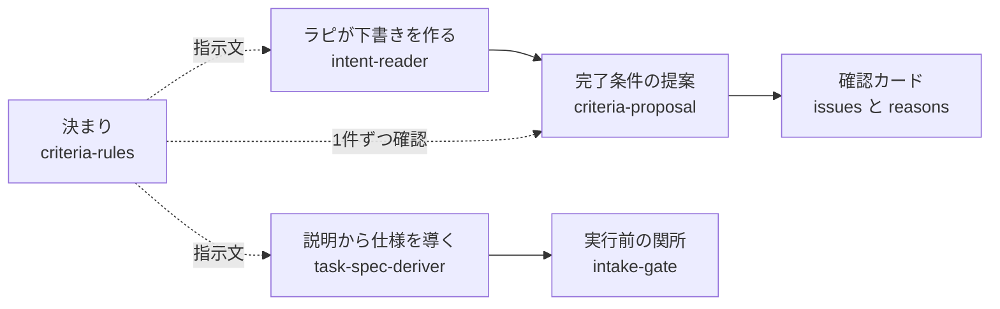

# タスクの書き方

タスクには、エージェントが迷わず進められ、終わったかどうかを機械的に判断できるだけの情報を書く。完了条件が曖昧だったり、作業中のエージェントには確かめられない条件だったりしたことが、タスクが失敗し続ける主な原因だった（#1545）。

## 項目

| 項目 | 書くこと | 欄 |
| --- | --- | --- |
| ゴール | 終わったときに何がどうなっているかを1〜2文で書く。「〜を実装する」ではなく「〜できる状態」と書く | `goals` |
| 背景 | なぜ必要か、いまどうなっているか、参照すべきファイルや Issue | `description` |
| 範囲外 | 今回やらないこと | 未対応（予定） |
| 開始条件 | 先に終わっている必要があるタスクと、着手前に必要な状態 | 未対応（予定） |
| 制約 | 守るべきこと（触ってはいけない場所、互換性、性能） | `constraints` |
| 成果物 | 何を出したら終わりか（PR、ノート、報告、判断） | 未対応（予定） |
| 受け入れ条件 | エージェントが自分で確かめられる条件 | `acceptanceCriteria` |
| 本人が確かめること | 見た目や使い心地など、人にしか判断できないこと | `userAcceptanceChecks` |

## 受け入れ条件の決まり

受け入れ条件は、作業中のエージェントが自分で確かめられる形に限る。

1. 1件ごとに確認方法を添える。テスト名、コマンド、ファイル、API、数値のどれかで書く。
2. 作業中のエージェントが確かめられない条件を書かない。CI の結果、PR のマージ後、本番やデプロイ後の状態、人の操作がこれにあたる。
3. 既存のテストファイルやテスト全体が「すべて通る」ことを条件にしない。変更前から落ちているテストまで直さないと満たせなくなる。「変更前に通っていたテストが変更後もすべて通り、新しく足したテストがすべて通る」と、変更前と比べる形で書く。
4. 「〜しない」だけで終わる条件を書かない。代わりに何がどうなるかを書く。
5. 調査・監査・報告が成果物のタスクには、「直す必要がなければ、変更不要とその根拠を書いて完了とする」という条件を入れる。
6. 人にしか判断できないことは、受け入れ条件ではなく本人が確かめる項目に分ける。

| 決まり | 悪い例 | 良い例 |
| --- | --- | --- |
| 確認方法を添える | 検索機能を実装する | `GET /tasks?q=abc` が該当タスクだけを返す（確認方法: 検索 API のテスト） |
| 届かない条件を書かない | CI がすべて通ること | `bunx tsc --noEmit` がエラー 0 で終わる |
| 変更前と比べる | 既存のテストがすべて通る | 変更前に通っていたテストが変更後もすべて通り、新しく足したテストがすべて通る（変更前から落ちているテストは件数と原因を書く） |
| 否定だけで終わらない | エラーを表示しないこと | 空の一覧ではエラーを出さず、「タスクはありません」と表示する |
| 変更不要の終わり方 | 監査結果をまとめる | 監査結果を報告にまとめ、直す必要がなければ変更不要とその根拠を書く |

> [!IMPORTANT]
> 届かない条件が1件でもあると、検証担当は正直に「未確認」と書き、検証のやり直しが止まらなくなる。実装が正しくても完了しない。

## 決まりを効かせる場所

- `rapitas-backend/services/assistant/criteria-rules.ts` が決まりの本体である。AI に渡す指示文（`CRITERIA_RULES_PROMPT`）と、1件ずつの確認（`findCriterionIssues`）、タスク全体の確認（`findSpecIssues`）を同じ場所に置き、ずれないようにしている。
- ラピの下書き（`intent-reader.ts`）と、説明から仕様を導く処理（`task-spec-deriver.ts`）の指示文に、同じ決まりを入れている。
- 完了条件の提案（`criteria-proposal.ts`）は、決まりに反する条件に `issues` を付け、`quality.reasons` に理由と言い換えの案を書く。

> [!NOTE]
> 3 は試験運用（試験タスク #1498）で見つかった。テストファイル全体の成功を条件にしたところ、変更前から Windows で落ちていた12件のために、正しい実装でも条件を満たせなかった。変更前と比べる形に直すと、検証は通った。

> [!NOTE]
> 確認は助言で、タスクの作成や実行は止めない。実行前に止めるかどうかは、試験運用の結果を見て決める。
