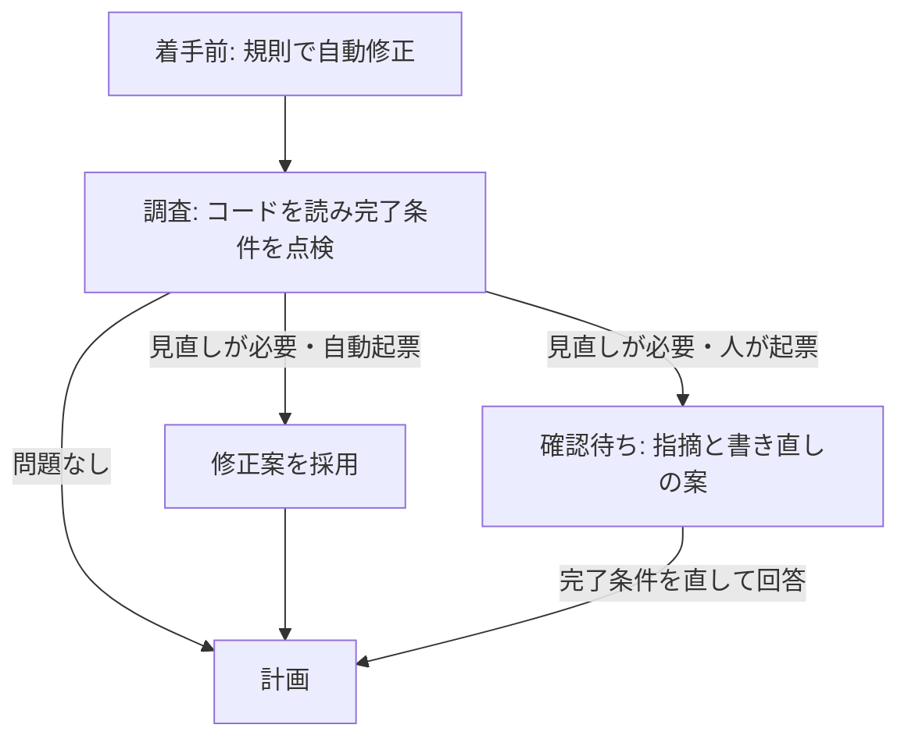
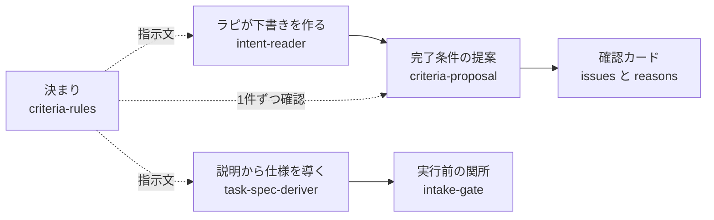

# タスクの書き方

タスクには、エージェントが迷わず進められ、終わったかどうかを機械的に判断できるだけの情報を書く。完了条件が曖昧だったり、作業中のエージェントには確かめられない条件だったりしたことが、タスクが失敗し続ける主な原因だった（#1545）。

## 項目

| 項目 | 書くこと | 欄 | 開発プロジェクトで |
| --- | --- | --- | --- |
| ゴール | 終わったときに何がどうなっているかを1〜2文で書く。「〜を実装する」ではなく「〜できる状態」と書く | `goals` | 必須 |
| 背景 | なぜ必要か、いまどうなっているか、参照すべきファイルや Issue | `description` | 推奨 |
| 範囲外 | 今回やらないこと | `outOfScope` | 推奨 |
| 開始条件 | 先に終わっている必要があるタスクと、着手前に必要な状態 | `TaskDependency`（先に終わらせるタスク）と `startConditions`（言葉で書く条件） | 任意 |
| 制約 | 守るべきこと（触ってはいけない場所、互換性、性能） | `constraints` | 任意 |
| 成果物 | 何を出したら終わりか。`pr`・`report`・`decision` のどれか | `deliverable` | 必須（未入力は `pr` とみなす） |
| 受け入れ条件 | エージェントが自分で確かめられる条件 | `acceptanceCriteria` | 完了条件として、どちらか1件以上が必須 |
| 本人が確かめること | 見た目や使い心地など、人にしか判断できないこと | `userAcceptanceChecks` | 同上 |

## 必須項目の確認

開発プロジェクト（AI エージェントが実行するテーマ）のタスクは、ゴールと完了条件がそろうまで着手しない（#1555）。個人のタスクには求めない。

1. 着手前の関所（`services/intake/intake-gate.ts`）が、説明文からゴールや受け入れ条件を補ったあとで、`services/intake/intake-required-spec.ts` を呼ぶ。
2. 足りない項目があれば、何が足りないかを書いた質問を作り、タスクを確認待ち（`awaiting_question`）にする。自動実行は確認待ちのタスクを選ばない。
3. 項目を入力して質問に答えると、関所がもう一度確かめる。足りないままなら、また止まる。推測で進めることはしない。

成果物が未入力のときは PR とみなす。自動で起票されるタスク（CI の監視など）が、成果物の欄がないだけで止まらないようにするためである。範囲外と成果物は、実装担当が作業中に立ち返るゴールアンカー（`services/workflow/workflow-goal-anchor.ts`）に載る。

## 開始条件

開始条件は2種類ある（#1559）。

| 種類 | 書き方 | 効き方 |
| --- | --- | --- |
| 先に終わらせるタスク | タスク詳細の「先に終わらせるタスク」にタスク番号を入れる | すべて完了するまで、自動実行はそのタスクを選ばない。手動で始めると、未完了のタスクを挙げて断る |
| 言葉で書く条件 | 「開始条件」の欄に1行1項目で書く | 機械では確かめない。エージェントへの指示に載り、満たされていなければ作業せず報告させる |

- 自分自身、存在しないタスク、お互いを待つ循環は登録できない。
- 先に終わらせるタスクが中止になった場合も、待ったままになる。詳細画面に「未完了」と出るので、外すか置き換える。
- 自動実行の選び方（`selectNextTask`）と、再開の判断に使う数え方（`eligibleTopLevelTodoWhere`）には、同じ条件（`UNMET_DEPENDENCIES_EXCLUDED`）を入れている。2つがずれると、選んでは断るのを繰り返すためである。

## サブタスク

サブタスクは親タスクの手順として扱い、仕様は親で定義する（#1559）。

- ゴール・範囲外・制約・成果物は書かない。親のものを引き継ぐ。
- 完了条件は任意で書ける。書かなければ親の完了条件で判断する。
- 着手前の必須項目の確認は、サブタスク自身に項目がなければ親の項目で判定する。
- エージェントへの指示（ゴールアンカー）には、親のゴール・範囲外・成果物が載る。

## 成果物と完了の判定

| 成果物 | エージェントが出すもの | 完了 |
| --- | --- | --- |
| PR | コード・設定・ドキュメントの変更 | PR ができる |
| 報告 | verify.md の報告 | 変更がなければ「## 結論: 修正不要」と根拠を書く |
| 判断 | 選択肢と推奨 | 同上（判断が成果物であることを書く） |

完了の判定の本体（`services/workflow/completion-gate.ts`）は保護対象のため、成果物を直接は読まない。報告と判断は、エージェントへの指示で「修正不要」の書き方を求め、既存の「変更不要の根拠があれば完了」の経路で完了させる。ノートはエージェントが作る手段がまだないため、選択肢に出していない。

## 完了条件の確認

完了条件の不備は、実装を走らせて差し戻されてから分かると、1回分のトークンと時間を失う。そこで、計画を作る前に2段で確かめる（#1561）。

| 段 | いつ | 何を | 見つけたとき |
| --- | --- | --- | --- |
| 規則による自動修正 | 着手前の関所（`services/intake/intake-criteria-check.ts`） | 過去の失敗で裏付けのある書き方の誤り（届かない条件、既存テスト全体の成功、報告タスクの「変更不要」の終わり方） | 決まった形に書き換え、`criteria_auto_fixed` を記録する |
| 調査担当の点検 | 調査の段階（research.md の `## 完了条件の点検`） | コードを読んだうえで、確かめられるか、制約・範囲外と矛盾しないか、ゴールに届くか、読み方が割れないか | 人が起票したタスクは確認待ちにする。自動で起票されたタスクは修正案を採用する |

- 計画は完了条件が確定してから作る。確認待ちの間は、計画にも実装にも進まない。
- 回答すると、調査はやり直さずに `research_done` から計画へ進む（質問の種類は続きからの再開、`execution_continuation`）。
- 調査担当の点検の結果は `criteria_reviewed` として指摘の種類ごとに記録する。何度も当たる種類は、根拠を示したうえで規則による自動修正に移す。
- 成果物が PR のタスクでも、調べた結果変更が不要なら「## 結論: 修正不要」と根拠を書いて完了できる。PR が必要なのは変更があるときだけである。

## 受け入れ条件の決まり

受け入れ条件は、作業中のエージェントが自分で確かめられる形に限る。

1. 1件ごとに確認方法を添える。テスト名、コマンド、ファイル、API、数値のどれかで書く。
2. 作業中のエージェントが確かめられない条件を書かない。CI の結果、PR のマージ後、本番やデプロイ後の状態、人の操作がこれにあたる。
3. 既存のテストファイルやテスト全体が「すべて通る」ことを条件にしない。変更前から落ちているテストまで直さないと満たせなくなる。「変更前に通っていたテストが変更後もすべて通り、新しく足したテストがすべて通る」と、変更前と比べる形で書く。
4. 「〜しない」だけで終わる条件を書かない。代わりに何がどうなるかを書く。
5. 調査・監査・報告が成果物のタスクには、「直す必要がなければ、変更不要とその根拠を書いて完了とする」という条件を入れる。
6. 人にしか判断できないことは、受け入れ条件ではなく本人が確かめる項目に分ける。

| 決まり | 悪い例 | 良い例 |
| --- | --- | --- |
| 確認方法を添える | 検索機能を実装する | `GET /tasks?q=abc` が該当タスクだけを返す（確認方法: 検索 API のテスト） |
| 届かない条件を書かない | CI がすべて通ること | `bunx tsc --noEmit` がエラー 0 で終わる |
| 変更前と比べる | 既存のテストがすべて通る | 変更前に通っていたテストが変更後もすべて通り、新しく足したテストがすべて通る（変更前から落ちているテストは件数と原因を書く） |
| 否定だけで終わらない | エラーを表示しないこと | 空の一覧ではエラーを出さず、「タスクはありません」と表示する |
| 変更不要の終わり方 | 監査結果をまとめる | 監査結果を報告にまとめ、直す必要がなければ変更不要とその根拠を書く |

> [!IMPORTANT]
> 届かない条件が1件でもあると、検証担当は正直に「未確認」と書き、検証のやり直しが止まらなくなる。実装が正しくても完了しない。

## 決まりを効かせる場所

- `rapitas-backend/services/assistant/criteria-rules.ts` が決まりの本体である。AI に渡す指示文（`CRITERIA_RULES_PROMPT`）と、1件ずつの確認（`findCriterionIssues`）、タスク全体の確認（`findSpecIssues`）を同じ場所に置き、ずれないようにしている。
- ラピの下書き（`intent-reader.ts`）と、説明から仕様を導く処理（`task-spec-deriver.ts`）の指示文に、同じ決まりを入れている。
- 完了条件の提案（`criteria-proposal.ts`）は、決まりに反する条件に `issues` を付け、`quality.reasons` に理由と言い換えの案を書く。

3 は試験運用（試験タスク #1498）で見つかった。テストファイル全体の成功を条件にしたところ、変更前から Windows で落ちていた12件のために、正しい実装でも条件を満たせなかった。変更前と比べる形に直すと、検証は通った。

> [!NOTE]
> 確認は助言で、タスクの作成や実行は止めない。実行前に止めるかどうかは、試験運用の結果を見て決める。
