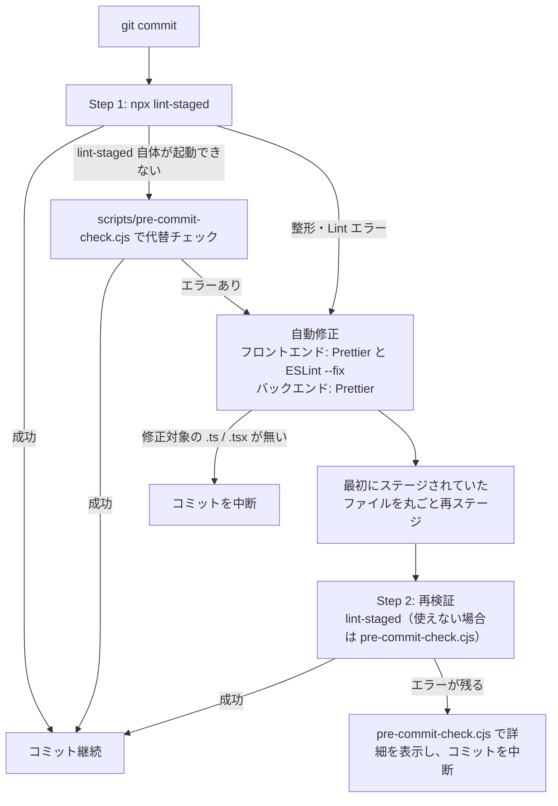

# コミット前チェックガイド

## 概要

コミット時の Git フックは、ステージしたファイルの整形と Lint を自動で行う。自動修正で直ればコミットはそのまま続き、直らない場合だけ詳細なエラーを表示してコミットを止める。

フックは husky で登録されている。

| フック | 実行するもの | 止める条件 |
| --- | --- | --- |
| `.husky/pre-commit` | `scripts/auto-fix-commit.cjs`（lint-staged と自動修正） | 自動修正後も整形・Lint エラーが残る |
| `.husky/commit-msg` | commitlint（`commitlint.config.js`） | コミットメッセージが規約に合わない |
| `.husky/pre-push` | `main` への直接 push の拒否と、フロントエンド・バックエンドの型チェック | `main` への push、または `tsc --noEmit` の失敗 |

## lint-staged の対象

ルートの `package.json` の `lint-staged` 設定で、ステージされたファイルの種類ごとに処理が決まる。

| 対象 | 処理 |
| --- | --- |
| `rapitas-frontend/src/**/*.{ts,tsx}` | `prettier --write`、`eslint --fix`（`rapitas-frontend/eslint.config.mjs`、`--max-warnings=9999` なので警告では止まらない） |
| `rapitas-backend/**/*.ts` | `prettier --write` のみ（ESLint はかけない） |
| `rapitas-backend/prisma/**/*.prisma` | `scripts/prisma-generate-hook.cjs`（Prisma Client の再生成。失敗するとコミットを中断） |

## pre-commit の処理フロー

`scripts/auto-fix-commit.cjs` は次の順に処理する。

> [!NOTE]
> 再ステージは修正したファイルだけでなく、最初にステージされていたファイル全体に対して `git add` する。部分的にステージしていたファイルは、ステージしていなかった変更も含めてコミットされる。

エラーが残った場合の出力には、ファイル名・行番号・ESLint のメッセージと、次の対処手順が含まれる。

## 自動修正できないエラーの対処

1. 表示されたファイルと行を確認する。改めて確認したいときは `npm run check:commit` を実行する。
2. エラーを手で修正する。
3. `git add` で再ステージし、もう一度 `git commit` する。自動修正は再び走る。

`git commit --no-verify` でフックを飛ばせるが、CI の Lint で同じエラーが落ちるため使わない。

### よくあるエラー

| エラー | 修正方法 |
| --- | --- |
| Prettier の `[warn] src/components/Example.tsx` | `cd rapitas-frontend` の後に `npx prettier --write <ファイル>` |
| `'variableName' is assigned a value but never used` | 変数を削除する、使う、または意図的に使わないなら `_variableName` に改名する |
| `React Hook useEffect has missing dependencies` | 依存配列に値を足す、または `useCallback` / `useMemo` で包む。eslint-disable コメントは最後の手段 |

## 手動コマンド

| コマンド | 説明 |
| --- | --- |
| `npm run check:commit` | ステージ済みファイルの整形と Lint を詳しく表示する（`scripts/pre-commit-check.cjs`） |
| `npm run lint:fix` | フロントエンドの `src` に Prettier と ESLint --fix、バックエンド全体に Prettier をかける |
| `npm run lint:all` | フロントエンドとバックエンドの Lint を並列に実行する |
| `cd rapitas-frontend && pnpm run lint` | フロントエンドだけ Lint する |
| `cd rapitas-backend && bun run lint` | バックエンドだけ Lint する |

コミット前にまとめて直したい場合は、`npm run lint:fix` の後に `git add` してからコミットする。

## トラブルシューティング

### lint-staged が終わらない

ステージしたファイルが多いと ESLint に時間がかかる。`Ctrl+C` で中断し、`git restore --staged <ファイル>` でステージを減らしてから分けてコミットする。

> [!WARNING]
> 中断したコミットは作られていない。`git reset HEAD~1` を実行すると、直前の既存コミットを取り消してしまう。

### 改行コードの警告

`warning: in the working copy of 'file.ts', LF will be replaced by CRLF` は警告だけで、コミットは成功する。改行コードは `.gitattributes` で統一されている。
